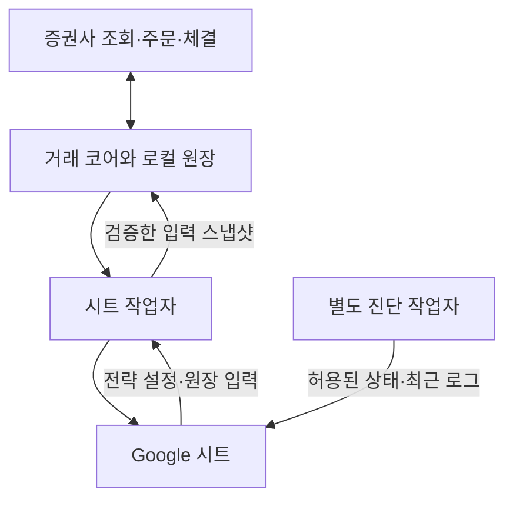

# 구조와 소스 위치

아래 경로는 해당 릴리스의 전체 Verification ZIP을 푼 루트를 기준으로 합니다. 공개 저장소의 `releases/<버전>/source/` 발췌본과 혼동하지 않습니다.

| 경로 | 역할 | 먼저 찾을 함수 |
| --- | --- | --- |
| `host/At58.Host.ps1` | 번들 실행, 업데이트 전환, 정상 조회 검증, 이전 번들 복구 | `Start-Bundle`, `Rollback-Bundle` |
| `host/At58.Update.ps1` | 서명된 피드·패키지·manifest 검증, 다운로드·스테이징 | `Up-Envelope`, `Up-RemoteRefresh`, `Up-Validate` |
| `bundle/At58.Manager.ps1` | 앱 실행 감시, 상태 분류, 알림 대기열, 복구·업데이트 조정 | `Start-Managed`, `Queue-Manager`, `Flush-Manager` |
| `bundle/At58.Ops.ps1` | 안전한 파일 교체, 프로세스·상태 판정, 장애·시장 알림 조건 | `Ops-WriteJson`, `Ops-Classify`, `Ops-LiveMaintenance`, `Ops-MarketNotice` |
| `bundle/payload/esbada_Merits_AT_v58.ps1` | Windows UI, 작업자 연결, 실주문 시작·중지 요청, 트레이·창 설정 | `Live-TelegramTick`, 업데이트 버튼 처리 |
| `bundle/payload/At58.Core.ps1` | 증권사 조회, 전략 입력 검증, 원장 대조, 계획, 주문·체결 관리 | 아래 기능 표 참조 |
| `bundle/At58.SheetWorker.ps1` | 시트 인증·구조 확인, 전략 입력 읽기, 일지 검증, 표시·자산 보고 | 일반 실행 / `-Diagnostics` 분기 |
| `bundle/At58.Sheets.ps1` | 시트 데이터 생성·동기화·자산 내역·진단 전송 | `Sheet-StrategyInput`, `Sheet-JournalSync`, `Sheet-PublishPresentation`, `Asset-Pump`, `SheetDiag-Run` |
| `bundle/At58.SheetsJwt.ps1` | 로컬 서비스 계정 키를 이용한 Google 인증 서명 | JWT 지원 클래스 |
| `bundle/At58.Telegram.ps1` | Telegram 설정, 알림 전송, 실주문 시작 승인 버튼 | `Tg-Notify`, `Tg-EventText`, `TgC-Step` |
| `bundle/At58.Repair.ps1` | 관리자에서 요청한 코드 분석·수정 검증 작업 | 파일의 실행 진입점 |
| `bundle/payload/At58.Log.ps1` | 상태·로그 읽기 및 표시 | `Convert-At58LogRecord` |

`host/At58.Ops.ps1`와 `bundle/At58.Ops.ps1`는 서로 다른 배포 경계에 있습니다. 같은 파일명이라고 하나만 수정하고 동작이 동일할 것으로 가정하지 않습니다.

## 거래 코어의 기능별 위치

| 기능 | 함수 묶음 |
| --- | --- |
| 증권사 원본 응답 정규화와 계좌 스냅샷 | `At58-Session`, `At58-ReadSnapshot` |
| 전략 입력, 장세·차수별 기준표 및 계획 | `At58S-*` |
| 지정가, 호가·당일 가격 제한, 주문 응답 | `At58O-*` |
| 주문 원장, 전송 전 검사, 접수·체결 대조 | `At58T-*` |
| 실전 실행, 대조, 사용자 승인, 일자 전환 | `At58X-*` |
| 하루 서로 다른 매수 차수 제한 | `At58D-*` |
| 현금 이자·거래 내역 대조 | `At58I-*` |
| 접수·체결 수신 | `At58E-*` |
| 자동 시작과 Telegram 승인 재검증 | `At58AS-*`, `At58TG-*` |
| 입력 갱신 과정의 진단 | `At58ID-*` |
| 합성 거래소·모의 검증 | `At58Sim-*`, `At58C-*` |

## 거래와 시트의 관계

거래 코어는 증권사의 시세·잔고·미체결을 직접 조회합니다. 시트는 화면 표시뿐 아니라 전략 설정과 원장 입력에도 관여하므로, 표시 전송을 줄이는 작업과 전략 입력 갱신을 분리해야 합니다. 실전 입력은 120초를 넘으면 대기 상태로 전환됩니다. 1.1.6 최적화안에서도 이 유효시간과 시트 작업 완료 후 10초의 다음 실행 대기는 유지합니다. 정상 시트 작업과 진단 작업은 관리자가 각각 실행하며, 진단 전송 실패 때문에 전략 입력 갱신을 멈추지 않습니다.

## 시트 탭과 소유권

| 탭 | 주된 목적 | 코드 소유자 |
| --- | --- | --- |
| 메인 | 현재 자산, 장세, 차수별 기준표·주문 시도 표시 | `Sheet-Main` |
| 자동매매현황 | 조회·대조·실주문 상태 요약 | `Sheet-BuildLive` |
| AT주문내역 | 주문·체결 상태 표시 | `Sheet-BuildLive` |
| 매매일지 | 같은 주문의 분할 체결 합산, 실제 체결 금액·손익 | `Sheet-Journal*` |
| 자산상세내역 | 일별 비용, 거래 내역, 누적 자산 보고 | `Asset-*` |
| 매매기준 | 전략 파라미터 입력 | `Sheet-StrategyInput`, `At58S-Import` |
| 사이클관리 | 사이클 및 원장 대조 기준 | `Sheet-StrategyInput`, `At58S-Import` |
| 운영설정 | 종목·장세별 허용 등 운영 입력 | `Sheet-ImportSettings` |
| 메인PC_진단 | 허용된 상태 파일과 최근 로그 | `SheetDiag-*` |

실제 파일 주소와 서비스 계정 설정은 PC의 `sheets.json`에서 확인합니다. 공개 문서에 사용자별 주소를 고정하지 않습니다.

## 1.1.6 표시 전송 최적화

`Sheet-PresentationPlan`은 원래 전체 표시 범위를 검증한 뒤 이전 성공 시점의 범위별 해시와 비교합니다. `Sheet-PublishPresentation`은 달라진 범위만 쓰고, 매 5분마다 전체 허용 범위를 다시 씁니다. `AT주문내역`의 행이 줄어들 때는 이전 범위까지 빈 값을 보내 남은 주문이 보이지 않게 정리합니다. 전략 입력 읽기·저장과 매매일지 검증은 이 표시 처리보다 먼저 실행합니다.

일반 표시 캐시는 `presentation-state.json`에 범위·해시·주문 행 수·성공 시각만 저장합니다. 시트와 계좌 범위가 바뀌거나 캐시가 유효하지 않으면 전체 표시를 다시 씁니다. 네트워크 전송 전에 미확정 표시를 남기고 성공 응답을 검증한 후 캐시를 확정하므로, 서버 반영 뒤 응답이 끊겨도 다음 실행에서 전체 범위를 복구합니다.

자산 보고의 `Asset-PublishPlan`·`Asset-Publish`도 변경된 값과 필요한 서식만 전송합니다. 보고 값의 전체 재전송은 5분 간격이며, 행 추가는 실제 내역이 현재 시트 용량을 넘을 때 수행합니다. 값이 같다는 이유로 새로운 원장 조회·장 마감 정산까지 완료했다고 처리하지 않습니다. 자산 표시 캐시는 `assets-presentation.dpapi`, 미확정 전송은 `assets-presentation-pending.dpapi`에 저장합니다.
